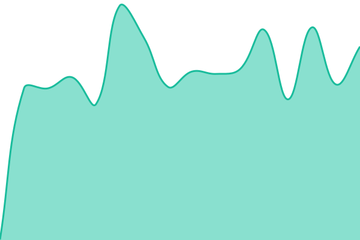
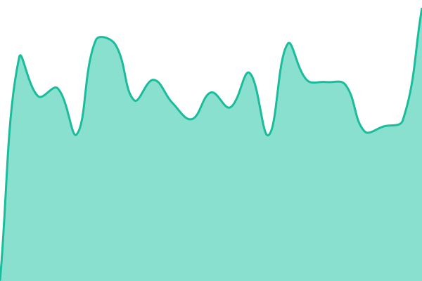
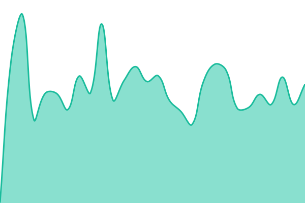

# [📈 Live Status](https://status.villasi.com.br): <!--live status--> **🟩 All systems operational**

This repository contains the open-source uptime monitor and status page for [rvsigor](https://status.villasi.com.br), powered by [Upptime](https://github.com/upptime/upptime).

With [Upptime](https://upptime.js.org), you can get your own unlimited and free uptime monitor and status page, powered entirely by a GitHub repository. We use [Issues](https://github.com/rvsigor/villasi-status/issues) as incident reports, [Actions](https://github.com/rvsigor/villasi-status/actions) as uptime monitors, and [Pages](https://status.villasi.com.br) for the status page.

<!--start: status pages-->
<!-- This summary is generated by Upptime (https://github.com/upptime/upptime) -->
<!-- Do not edit this manually, your changes will be overwritten -->
<!-- prettier-ignore -->
| URL | Status | History | Response Time | Uptime |
| --- | ------ | ------- | ------------- | ------ |
|  [Sistema (painel)](https://painel.villasi.com.br/api/saude) | 🟩 Up | [sistema-painel.yml](https://github.com/rvsigor/villasi-status/commits/HEAD/history/sistema-painel.yml) | 

 361ms
     
 | 

<a href="https://status.villasi.com.br/history/sistema-painel">87.41%</a>
    

|  [Página do Villasi](https://www.villasi.com.br) | 🟩 Up | [pagina-do-villasi.yml](https://github.com/rvsigor/villasi-status/commits/HEAD/history/pagina-do-villasi.yml) | 

 727ms
     
 | 

<a href="https://status.villasi.com.br/history/pagina-do-villasi">87.41%</a>
    

|  [Central de ajuda](https://help.villasi.com.br) | 🟩 Up | [central-de-ajuda.yml](https://github.com/rvsigor/villasi-status/commits/HEAD/history/central-de-ajuda.yml) | 

 309ms
     
 | 

<a href="https://status.villasi.com.br/history/central-de-ajuda">87.43%</a>
    

<!--end: status pages-->

[**Visit our status website →**](https://status.villasi.com.br)

## 📄 License

- Powered by: [Upptime](https://github.com/upptime/upptime)
- Code: [MIT](./LICENSE) © [Anand Chowdhary](https://anandchowdhary.com)
- Data in the `./history` directory: [Open Database License](https://opendatacommons.org/licenses/odbl/1-0/)
